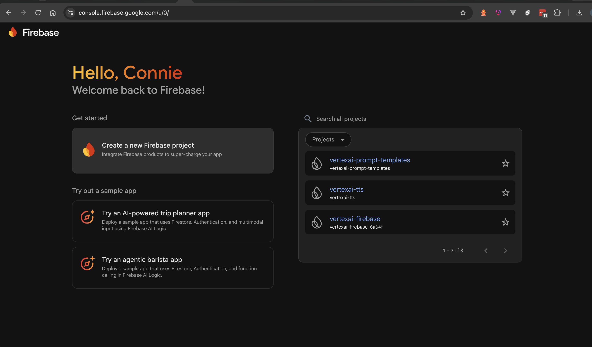
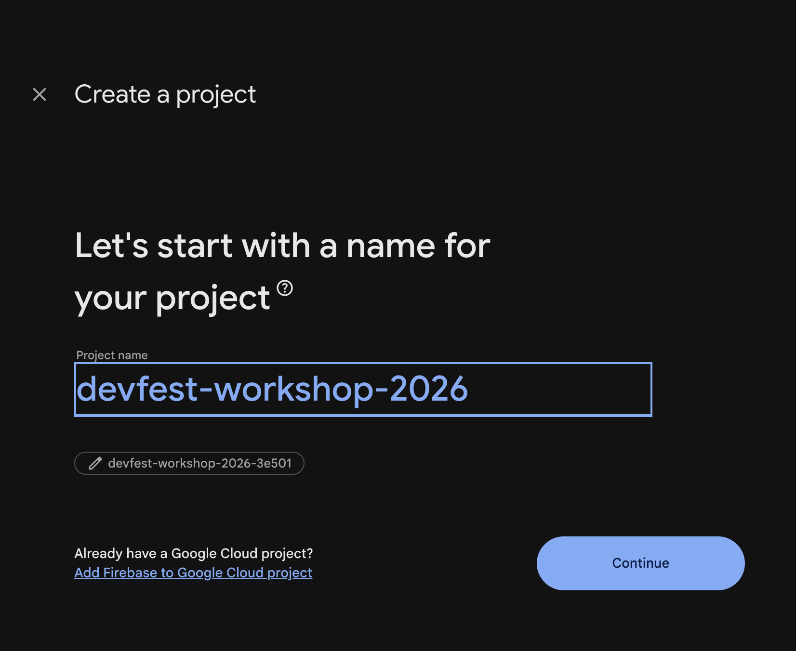
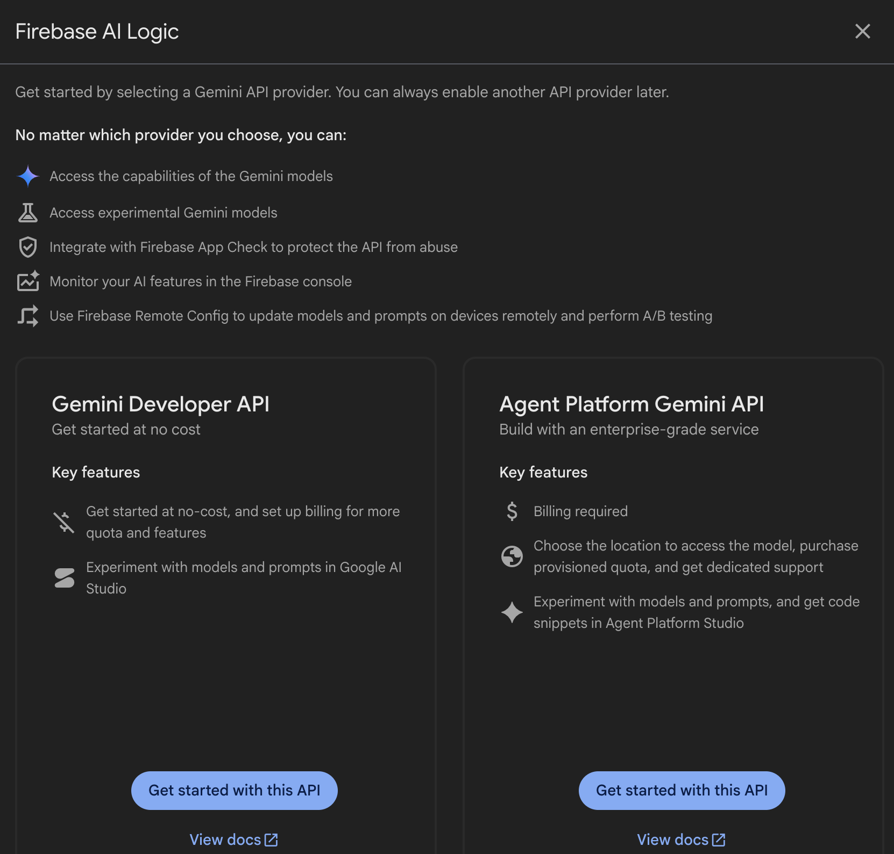
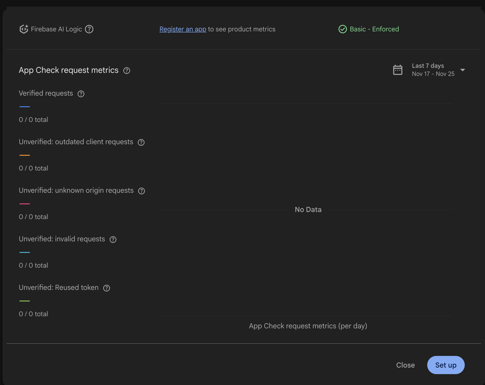
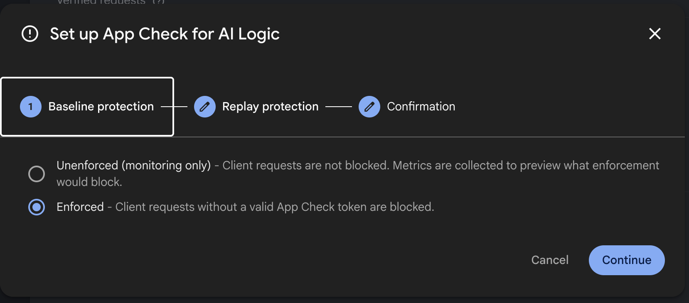
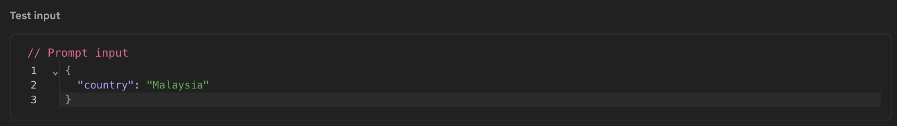
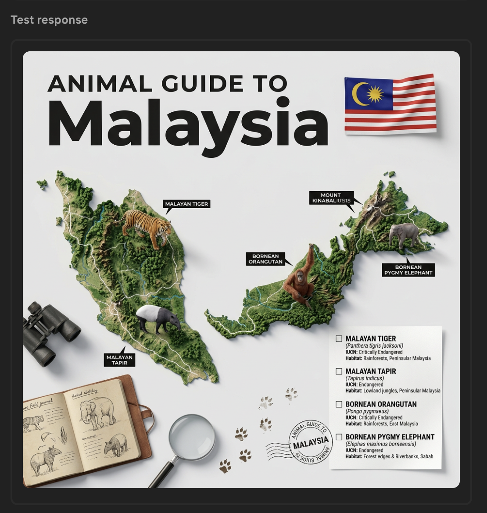

author:            Connie Leung
summary:           Building a workshop to build an Angular web app with Firebase AI Logic Server Prompt Template
id:                angular-firebase-ai-logic-server-prompt-template
categories:        technology, ai
environments:      Codelabs
status:            draft
feedback link:     https://github.com/railsstudent/devfest-2026-workshop

# Build an Angular Web App with Firebase AI Logic Server Prompt Templates

<!-- ------------------------ -->

## Overview and Prerequisites

Duration: 1

Welcome to the **Build an Angular Web App with Firebase AI Logic Server Prompt Templates** workshop! This workshop is split into two parts:

1. **Part 1: Firebase Configuration** — Set up a Firebase project, configure billing with Google Cloud Credits, enable Firebase AI Logic (in template-only mode) and App Check, create Server Prompt Templates, and configure Firebase Remote Config.
2. **Part 2: Angular Web App Integration** — Connect an Angular application to Firebase AI Logic and Remote Config to invoke your Server Prompt Templates securely from the client.

### Prerequisites

* **Node.js 24+** installed (<a href="https://nodejs.org/" target="_blank" rel="noopener">https://nodejs.org/</a>)
* A **Gmail / Google account**
* **Redeem the Google Cloud Credit** provided for this workshop before starting the Firebase billing setup.

<!-- ------------------------ -->

## Part 1: Create a Firebase Project and Web App

Duration: 3

1. Go to the Firebase Console at <a href="https://console.firebase.google.com/u/0/" target="_blank" rel="noopener">https://console.firebase.google.com/u/0/</a> to create a new Firebase project.

   

2. Create a Firebase project, enable Gemini in Firebase, and disable Google Analytics.

   

   

3. Once your project is created, add a new **Web App** (`</>`) to your Firebase project from the Project Overview page.

   

4. After adding Firebase to the web app, a Firebase configuration is created that we will use to initialize a Firebase app in the Angular app.

   

<!-- ------------------------ -->

## Part 1: Enable Firebase AI Logic

Duration: 2

### Enable Firebase AI Logic

1. In the Firebase Console sidebar, navigate to **Firebase -> AI Services -> AI Logic -> Get Started**.
2. Enable the **Gemini Developer API** provider. Click the **Get started with this API** button.

   

3. Keep the default settings to enable the API, AI Monitoring, and finish.
4. The overview of **Firebase AI Logic** displays the web app.

   

5. Click the **Settings** tab, scroll down to **Enforce template-only mode** to enable **template-only mode** so the client app can only execute pre-registered Server Prompt Templates.

   

<!-- ------------------------ -->

## Part 1: Enable App Check

Duration: 2

1. In the Firebase Console sidebar, navigate to **Firebase -> Security -> App Check -> APIs**.
2. Look for **Firebase AI Logic** and expand the accordion item.

   

3. Click **Set up** and configure the following protections:
   * **Baseline protection**: Select **Enforced**

     

   * **Replay protection**: Select **Enforced**

     

   * **Confirmation**: Confirm and save your App Check configuration.

<!-- ------------------------ -->

## Part 1: Assign Billing Account to the Firebase Project

Duration: 2

To use Gemini models and features in Firebase AI Logic, link your redeemed Google Cloud Credits billing account to your Firebase project:

1. Navigate to the Google Cloud Billing Projects page at <a href="https://console.cloud.google.com/billing/projects" target="_blank" rel="noopener">https://console.cloud.google.com/billing/projects</a>.
2. Locate your Firebase project, click the **three dots** (`⋮`) action menu at the end of the row, and choose **Change billing**.

   

3. Change the billing account to your **Google Cloud Credits** billing account and confirm.

   

<!-- ------------------------ -->

## Part 1: Create Server Prompt Templates

Duration: 15

In the Firebase Console sidebar, navigate to **Firebase -> AI Logic -> Prompt templates**:

You will create three Server Prompt Templates. For each template, copy the code blocks below into the corresponding sections in the Firebase Console UI:

* Copy the **Configuration** (`yaml`) block into the **Configuration** section.
* Copy the **Prompt text** block into the **Prompt text** section.
* Copy the **Prompt input** (`json`) block into the **Prompt input** section.

1. Click **Create Template -> Blank Template**.

---

### a) Country Animal Guide (`country-animal-guide-v0-0-1`)

* **Template Name**: Country Animal Guide
* **Template ID**: country-animal-guide-v0-0-1

* **Configuration**:

```yaml
model: "gemini-nano-banana-2.1"
config:
  candidateCount: 1
  thinkingConfig:
    thinkingLevel: MEDIUM
    includeThoughts: false
tools:
  - googleSearch
responseModalities: ["IMAGE"]
location: global
input:
  schema:
    country: string, The country name.
```

The configuration specifies the model name (Nano Banana 2.1), thinking configuration, Google Search grounding tool, response modalities (image), and input payload.

The Google Search tool is used to verify the country map outline, national flag, and native animals.
The input payload is a JSON object with a `country` property.


* **Prompt text**:

```text
First, use Google Search to look up and verify: (1) the accurate geographic map outline and national flag of {{country}}, and (2) the most iconic native wild animals of {{country}}, their exact scientific names, natural habitat regions, and current IUCN Red List conservation status. Then, generate a hyper-realistic 3D animal guide infographic poster for {{country}}. The country shape is rendered as a raised, textured terrain map floating on a clean light gray surface. The most iconic native wild animals of {{country}} are placed as highly detailed, photorealistic 3D sculpted miniature figures at their correct geographic habitats across the map — each animal must be anatomically accurate, instantly recognizable, and true to its natural environment. The terrain biomes change across the map to reflect each animal’s habitat. White paths connect the key regions across the terrain. Around the map, floating 3D decorative props are scattered: a pair of binoculars, a nature field journal, animal paw prints, a magnifying glass, and a postage stamp seal reading "Animal Guide to {{country}}" The national flag of {{country}} is shown as a small realistic folded flag in the upper right corner. Each animal has a bold black label on the map, and beside the map, each animal has a neat checklist showing: common name, scientific name, conservation status, and habitat region — in clean sans-serif typography. A large bold title at the top reads: “ANIMAL GUIDE TO {{country}}" in black uppercase typography with the word {{country}} in heavy bold. The overall aesthetic is premium editorial nature content — soft studio lighting, photorealistic 3D render, white/light gray background, clean layout.

Apply this aspect ratio to the image: 1:1.
Apply this resolution to the image: 512.
```


* **Prompt input**:

```json
{
  "country": "Malaysia"
}
```



Click the **Save template** button to save all the changes.

**Verify and Test:**

1. Click **Create formatted test request** to verify the request.
2. Click **Run Prompt test** to get the result.

   

---

### b) Country Food Guide (`country-food-guide-v-0-0-1`)

* **Template Name**: Country Food Guide
* **Template ID**: country-food-guide-v0-0-1

* **Configuration**:

```yaml
model: "gemini-nano-banana-2.1"
config:
  candidateCount: 1
  thinkingConfig:
    thinkingLevel: MEDIUM
    includeThoughts: false
tools:
  - googleSearch
responseModalities: ["IMAGE"]
location: global
input:
  schema:
    country: string, The country name.
```

* **Prompt text**:

```text
First, use Google Search to look up and verify: (1) the top 9 most iconic traditional dishes of {{country}}, their exact names, and their authentic visual presentation, and (2) the national flag, iconic landmarks, and traditional cultural symbols of {{country}}. Then generate a vintage editorial food poster, "Top 9 Dishes of {{country}}", aged parchment beige background, 3x3 grid layout of hyper-realistic photographed dishes each on a rustic ceramic plate, bold black and dark red serif typography for title, large country name in distressed slab-serif font, national flag top-left corner, iconic country landmarks illustrated in vintage engraving style as decorative header and footer borders, small cultural icon illustrations in corners (traditional figures, instruments, architecture), diamond ornamental dividers between sections, bold dish name caption beneath each photo, warm golden lighting on food, ultra-detailed, editorial infographic style.

Apply this aspect ratio to the image: 2:3.
Apply this resolution to the image: 512.
```

* **Prompt input**:

```json
{
  "country": "Malaysia"
}
```

Click the **Save template** button to save all the changes.

**Verify and Test:**

1. Click **Create formatted test request** to verify the request.
2. Click **Run Prompt test** to get the result.

---

### c) Summarize YouTube URL (`summarize-youtube-url-v-0-0-1`)

* **Template Name**: Summarize YouTube URL
* **Template ID**: summarize-youtube-url-v-0-0-1

* **Configuration**:

```yaml
model: "gemini-3.8-flash"
config:
  thinkingConfig:
    thinkingLevel: HIGH
    includeThoughts: false
location: global
input:
  schema:
     url: string
     mime_type: string
output:
  format: json
  schema:
    summary: string, summary of the URL
    topic?: string, topic of the URL
    tags(array, list of tags relevant to the video): string
```

* **Prompt text** (contains system instruction and user prompt):

```text
{{role "system"}}
You are an expert at summarizing videos, finding the topic, and generating tags relevant to their content. The user provides the URL and MIME type below. 

{{role "user"}}
{{media url="url" mimetype="mime_type"}}
```

* **Prompt input**:

```json
{
  "mime_type": "video/mp4",
  "url": "https://www.youtube.com/watch?v=BHGTA6ZEls4"
}
```

Click the **Save template** button to save all the changes.

**Verify and Test:**

1. Click **Create formatted test request** to verify the request.
2. Click **Run Prompt test** to get the result.

<!-- ------------------------ -->

## Part 1: Configure Firebase Remote Config

Duration: 2

In the Firebase Console sidebar, navigate to **Firebase -> DevOps & Engagement -> Feature Flagging -> Remote Config**. Instead of adding parameters manually one by one, you can upload a JSON template file that defines both Server Prompt Template ID parameters (`countryTemplateId` and `summarizeTemplateId`), their `STRING` data types, descriptions, and default values in a single step.


1. Download the template file: <a href="assets/remoteconfig.template.json" download="remoteconfig.template.json">Download remoteconfig.template.json</a>

   Its contents (shown below for reference) define both parameters:

```json
{
  "parameters": {
    "countryTemplateId": {
      "defaultValue": {
        "value": "country-food-guide-v-0-0-1"
      },
      "description": "Country Prompt Template Id",
      "valueType": "STRING"
    },
    "summarizeTemplateId": {
      "defaultValue": {
        "value": "summarize-youtube-url-v-0-0-1"
      },
      "description": "Summarize Template Id",
      "valueType": "STRING"
    }
  }
}
```

2. On the Remote Config welcome screen, click **upload template** (below **Create configuration**) and select `remoteconfig.template.json`. *(If your project already has a Remote Config configuration, click the `⋮` menu -> **Publish from a file** instead.)*
3. Review the imported parameters and click **Publish changes** to make them available to your application.

### Expected Output

After publishing, the Remote Config **Parameters** list displays both parameters with their default Server Prompt Template IDs:

* **`countryTemplateId`** (`String`): `country-food-guide-v-0-0-1` — *Country Prompt Template Id*
* **`summarizeTemplateId`** (`String`): `summarize-youtube-url-v-0-0-1` — *Summarize Template Id*


Your Angular application will fetch these values at runtime so you can switch prompt template versions in Firebase without redeploying the frontend.

<!-- ------------------------ -->

## Part 2: Angular Application Integration

Duration: 15

With the Firebase project, AI Logic Server Prompt Templates, App Check, and Remote Config parameters configured, you are ready to connect the Angular web application in Part 2 of this workshop.
