author:            Connie Leung
summary:           Building a workshop to build an Angular web app with Firebase AI Logic Server Prompt Template
id:                angular-firebase-ai-logic-server-prompt-template
categories:        technology, ai
environments:      Codelabs
status:            draft
feedback link:     https://github.com/railsstudent/devfest-2026-workshop

# Build an Angular Web App with Firebase AI Logic Server Prompt Templates

<!-- ------------------------ -->

## Overview and Prerequisites

Duration: 2

Welcome to the **Build an Angular Web App with Firebase AI Logic Server Prompt Templates** workshop! This workshop is split into two parts:

1. **Part 1: Firebase Configuration** — Set up a Firebase project, configure billing with Google Cloud Credits, enable Firebase AI Logic (in template-only mode) and App Check, create Server Prompt Templates, and configure Firebase Remote Config.
2. **Part 2: Angular Web App Integration** — Connect an Angular application to Firebase AI Logic and Remote Config to invoke your Server Prompt Templates securely from the client.

### Prerequisites

* **Node.js 24+** installed (<a href="https://nodejs.org/" target="_blank" rel="noopener">https://nodejs.org/</a>)
* **Git** installed
* A **Gmail / Google account**
* **Redeem the Google Cloud Credit** provided for this workshop before starting the Firebase billing setup.
* A **stable internet connection** (needed for `npm install`, Firebase CLI scripts, and Gemini AI Logic API calls; manual Firebase Console fallbacks are included if conference Wi-Fi slows down the scripts).

<!-- ------------------------ -->

## Part 1: Create a Firebase Project and Web App

Duration: 3

1. Go to the Firebase Console at <a href="https://console.firebase.google.com/u/0/" target="_blank" rel="noopener">https://console.firebase.google.com/u/0/</a> to create a new Firebase project.

   

2. Create a Firebase project, enable Gemini in Firebase, and disable Google Analytics.

   

   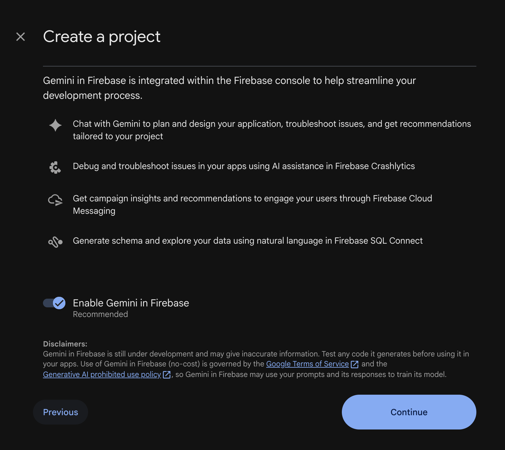

3. Once your project is created, add a new **Web App** (`</>`) to your Firebase project from the Project Overview page.

   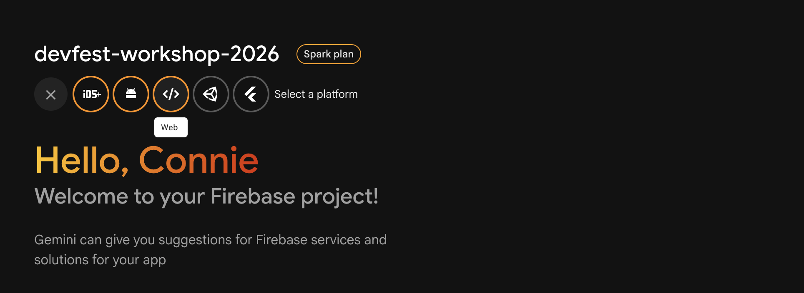

4. After adding Firebase to the web app, a Firebase configuration is created that we will use to initialize a Firebase app in the Angular app.

   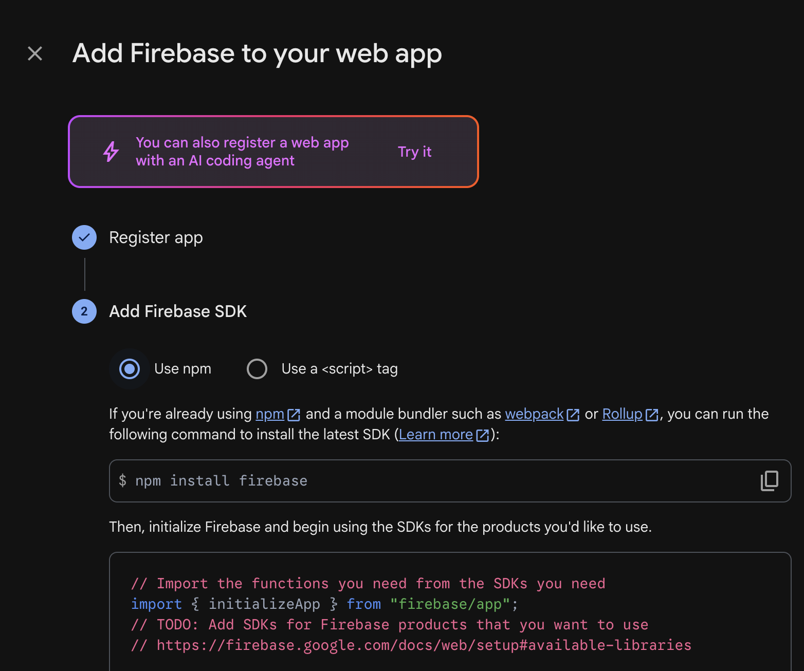

<!-- ------------------------ -->

## Part 1: Enable Firebase AI Logic

Duration: 2

### Enable Firebase AI Logic

1. In the Firebase Console sidebar, navigate to **Firebase -> AI Services -> AI Logic -> Get Started**.
2. Enable the **Gemini Developer API** provider. Click the **Get started with this API** button.

   

3. Keep the default settings to enable the API, AI Monitoring, and finish.
4. The overview of **Firebase AI Logic** displays the web app.

   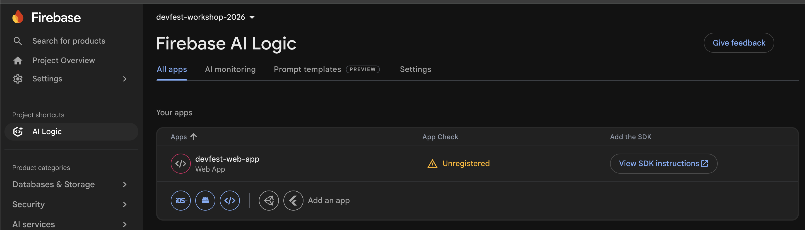

5. Click the **Settings** tab, scroll down to **Enforce template-only mode** to enable **template-only mode** so the client app can only execute pre-registered Server Prompt Templates.

   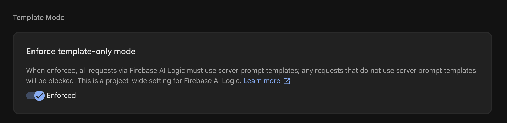

<!-- ------------------------ -->

## Part 1: Enable App Check

Duration: 2

1. In the Firebase Console sidebar, navigate to **Firebase -> Security -> App Check -> APIs**.
2. Look for **Firebase AI Logic** and expand the accordion item.

   

3. Click **Set up** and configure the following protections:
   * **Baseline protection**: Select **Enforced**

     

   * **Replay protection**: Select **Enforced**

     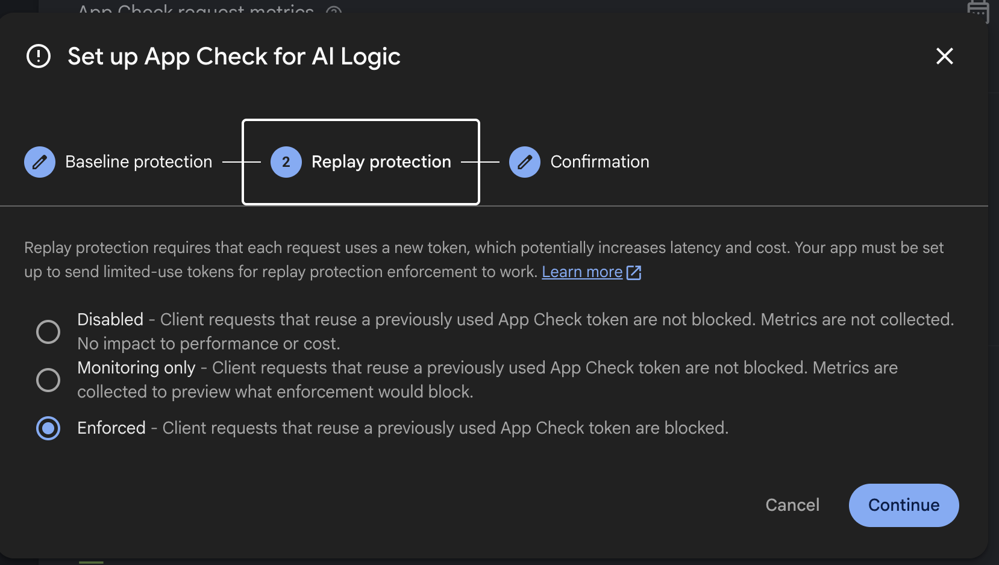

   * **Confirmation**: Confirm and save your App Check configuration.

<!-- ------------------------ -->

## Part 1: Assign Billing Account to the Firebase Project

Duration: 2

To use Gemini models and features in Firebase AI Logic, link your redeemed Google Cloud Credits billing account to your Firebase project:

1. Navigate to the Google Cloud Billing Projects page at <a href="https://console.cloud.google.com/billing/projects" target="_blank" rel="noopener">https://console.cloud.google.com/billing/projects</a>.
2. Locate your Firebase project, click the **three dots** (`⋮`) action menu at the end of the row, and choose **Change billing**.

   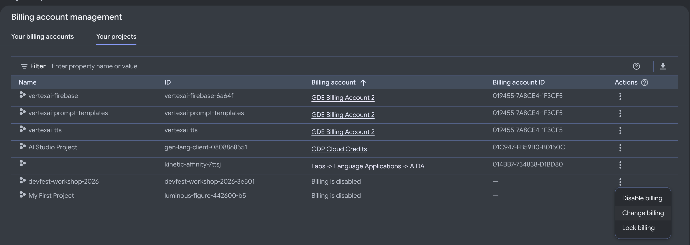

3. Change the billing account to your **Google Cloud Credits** billing account and confirm.

   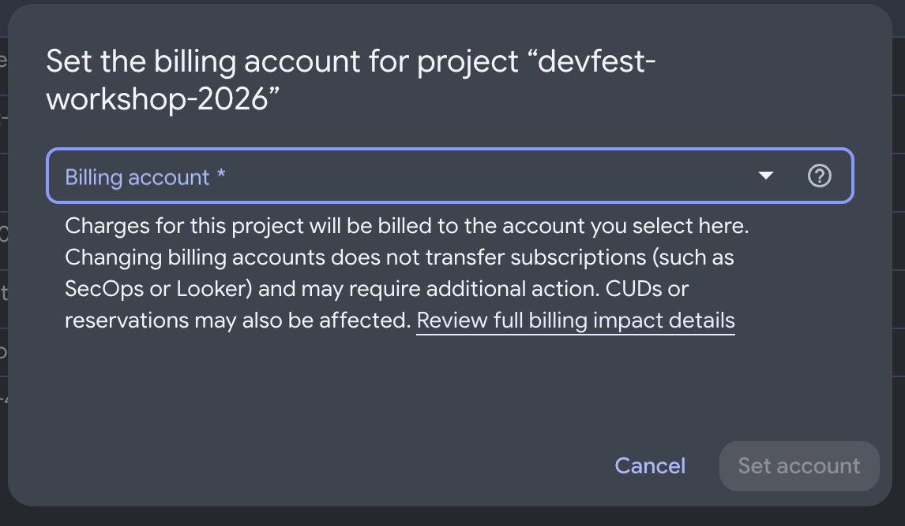

<!-- ------------------------ -->

## Part 1: Create Server Prompt Templates

Duration: 10

In the Firebase Console sidebar, navigate to **Firebase -> AI Logic -> Prompt templates**:

You will create three Server Prompt Templates. For each template, copy the code blocks below into the corresponding sections in the Firebase Console UI:

* Copy the **Configuration** (`yaml`) block into the **Configuration** section.
* Copy the **Prompt text** block into the **Prompt text** section.
* Copy the **Prompt input** (`json`) block into the **Prompt input** section.

1. Click **Create Template -> Blank Template**.

---

### a) Country Animal Guide (`country-animal-guide-v0-0-1`)

* **Template Name**: Country Animal Guide
* **Template ID**: country-animal-guide-v0-0-1

* **Configuration**:

```yaml
model: "gemini-nano-banana-2.1"
config:
  candidateCount: 1
  thinkingConfig:
    thinkingLevel: MEDIUM
    includeThoughts: false
tools:
  - googleSearch
responseModalities: ["IMAGE"]
location: global
input:
  schema:
    country: string, The country name.
```

The configuration specifies the model name (Nano Banana 2.1), thinking configuration, Google Search grounding tool, response modalities (image), and input payload.

The Google Search tool is used to verify the country map outline, national flag, and native animals.
The input payload is a JSON object with a `country` property.

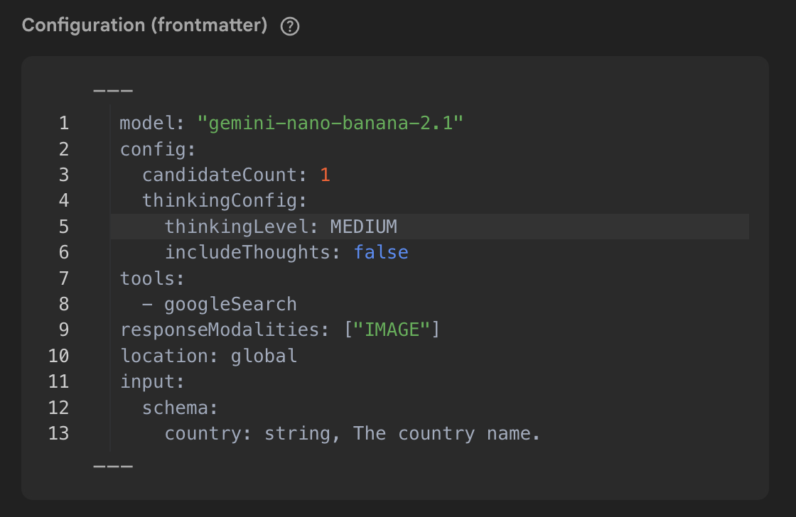

* **Prompt text**:

```text
First, use Google Search to look up and verify: (1) the accurate geographic map outline and national flag of {{country}}, and (2) the most iconic native wild animals of {{country}}, their exact scientific names, natural habitat regions, and current IUCN Red List conservation status. Then, generate a hyper-realistic 3D animal guide infographic poster for {{country}}. The country shape is rendered as a raised, textured terrain map floating on a clean light gray surface. The most iconic native wild animals of {{country}} are placed as highly detailed, photorealistic 3D sculpted miniature figures at their correct geographic habitats across the map — each animal must be anatomically accurate, instantly recognizable, and true to its natural environment. The terrain biomes change across the map to reflect each animal’s habitat. White paths connect the key regions across the terrain. Around the map, floating 3D decorative props are scattered: a pair of binoculars, a nature field journal, animal paw prints, a magnifying glass, and a postage stamp seal reading "Animal Guide to {{country}}" The national flag of {{country}} is shown as a small realistic folded flag in the upper right corner. Each animal has a bold black label on the map, and beside the map, each animal has a neat checklist showing: common name, scientific name, conservation status, and habitat region — in clean sans-serif typography. A large bold title at the top reads: “ANIMAL GUIDE TO {{country}}" in black uppercase typography with the word {{country}} in heavy bold. The overall aesthetic is premium editorial nature content — soft studio lighting, photorealistic 3D render, white/light gray background, clean layout.

Apply this aspect ratio to the image: 1:1.
Apply this resolution to the image: 512.
```

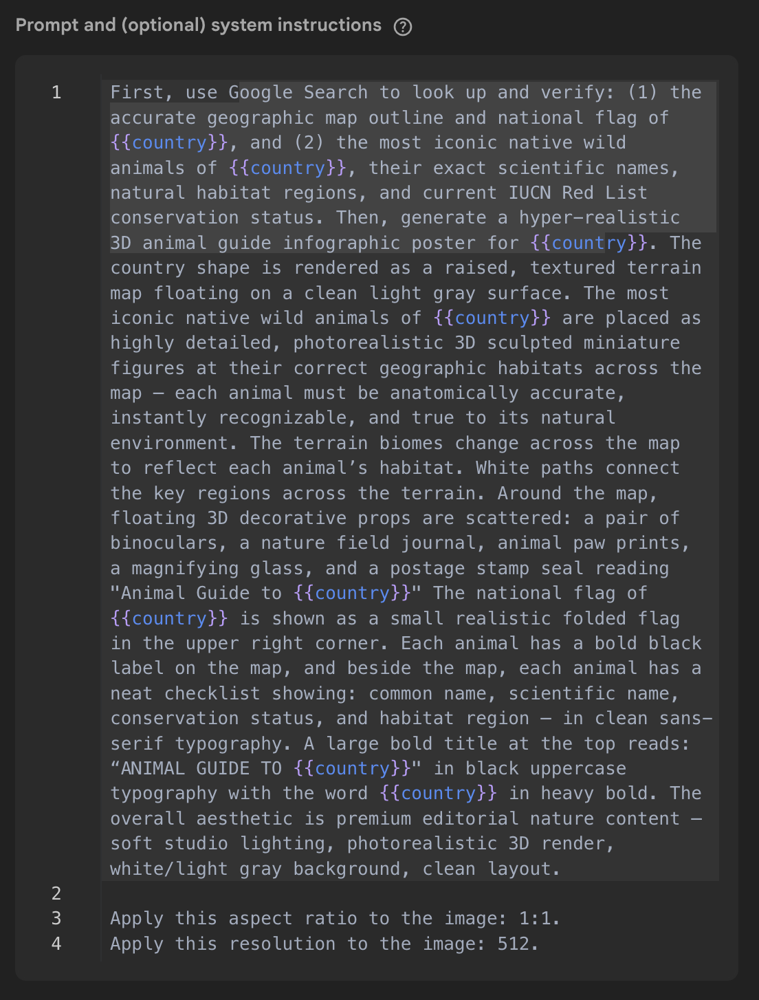

* **Prompt input**:

```json
{
  "country": "Malaysia"
}
```


Click the **Save template** button to save all the changes.

**Verify and Test:**

1. Click **Create formatted test request** to verify the request.
2. Click **Run Prompt test** to get the result.

   

---

### b) Country Food Guide (`country-food-guide-v0-0-1`)

* **Template Name**: Country Food Guide
* **Template ID**: country-food-guide-v0-0-1

* **Configuration**:

```yaml
model: "gemini-nano-banana-2.1"
config:
  candidateCount: 1
  thinkingConfig:
    thinkingLevel: MEDIUM
    includeThoughts: false
tools:
  - googleSearch
responseModalities: ["IMAGE"]
location: global
input:
  schema:
    country: string, The country name.
```

* **Prompt text**:

```text
First, use Google Search to look up and verify: (1) the top 9 most iconic traditional dishes of {{country}}, their exact names, and their authentic visual presentation, and (2) the national flag, iconic landmarks, and traditional cultural symbols of {{country}}. Then generate a vintage editorial food poster, "Top 9 Dishes of {{country}}", aged parchment beige background, 3x3 grid layout of hyper-realistic photographed dishes each on a rustic ceramic plate, bold black and dark red serif typography for title, large country name in distressed slab-serif font, national flag top-left corner, iconic country landmarks illustrated in vintage engraving style as decorative header and footer borders, small cultural icon illustrations in corners (traditional figures, instruments, architecture), diamond ornamental dividers between sections, bold dish name caption beneath each photo, warm golden lighting on food, ultra-detailed, editorial infographic style.

Apply this aspect ratio to the image: 2:3.
Apply this resolution to the image: 512.
```

* **Prompt input**:

```json
{
  "country": "Malaysia"
}
```

Click the **Save template** button to save all the changes.

**Verify and Test:**

1. Click **Create formatted test request** to verify the request.
2. Click **Run Prompt test** to get the result.

---

### c) Summarize YouTube URL (`summarize-youtube-url-v0-0-1`)

* **Template Name**: Summarize YouTube URL
* **Template ID**: summarize-youtube-url-v0-0-1

* **Configuration**:

```yaml
model: "gemini-3.8-flash"
config:
  thinkingConfig:
    thinkingLevel: HIGH
    includeThoughts: false
location: global
input:
  schema:
     url: string
     mime_type: string
output:
  format: json
  schema:
    summary: string, summary of the URL
    topic?: string, topic of the URL
    tags(array, list of tags relevant to the video): string
```

* **Prompt text** (contains system instruction and user prompt):

```text
{{role "system"}}
You are an expert at summarizing videos, finding the topic, and generating tags relevant to their content. The user provides the URL and MIME type below. 

{{role "user"}}
{{media url="url" mimetype="mime_type"}}
```

* **Prompt input**:

```json
{
  "mime_type": "video/mp4",
  "url": "https://www.youtube.com/watch?v=BHGTA6ZEls4"
}
```

Click the **Save template** button to save all the changes.

**Verify and Test:**

1. Click **Create formatted test request** to verify the request.
2. Click **Run Prompt test** to get the result.

<!-- ------------------------ -->

## Part 1: Configure Firebase Remote Config

Duration: 2

In the Firebase Console sidebar, navigate to **Firebase -> DevOps & Engagement -> Feature Flagging -> Remote Config**. Instead of adding parameters manually one by one, you can upload a JSON template file that defines both Server Prompt Template ID parameters (`countryTemplateId` and `summarizeTemplateId`), their `STRING` data types, descriptions, and default values in a single step.

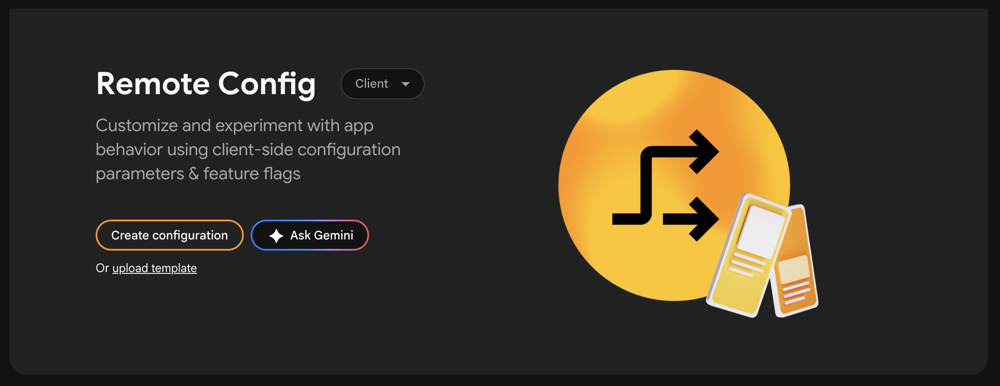

1. Download the template file: <a href="assets/remoteconfig.template.json" download="remoteconfig.template.json">Download remoteconfig.template.json</a>

   Its contents (shown below for reference) define both parameters:

```json
{
  "parameters": {
    "countryTemplateId": {
      "defaultValue": {
        "value": "country-food-guide-v0-0-1"
      },
      "description": "Country Prompt Template Id",
      "valueType": "STRING"
    },
    "summarizeTemplateId": {
      "defaultValue": {
        "value": "summarize-youtube-url-v0-0-1"
      },
      "description": "Summarize Template Id",
      "valueType": "STRING"
    }
  }
}
```

2. On the Remote Config welcome screen, click **upload template** (below **Create configuration**) and select `remoteconfig.template.json`. *(If your project already has a Remote Config configuration, click the `⋮` menu -> **Publish from a file** instead.)*
3. Review the imported parameters and click **Publish changes** to make them available to your application.

### Expected Output

After publishing, the Remote Config **Parameters** list displays both parameters with their default Server Prompt Template IDs:

* **`countryTemplateId`** (`String`): `country-food-guide-v-0-0-1` — *Country Prompt Template Id*
* **`summarizeTemplateId`** (`String`): `summarize-youtube-url-v-0-0-1` — *Summarize Template Id*

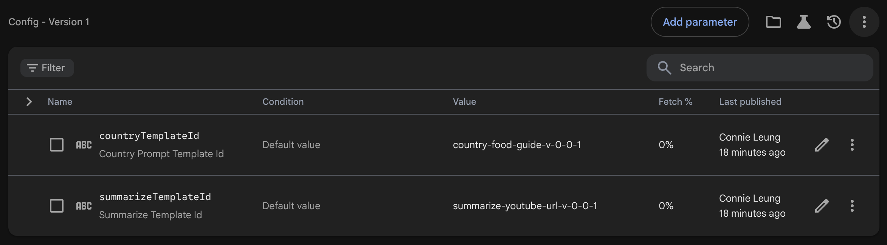

Your Angular application will fetch these values at runtime so you can switch prompt template versions in Firebase without redeploying the frontend.

<!-- ------------------------ -->

## Part 2: Clone Starter Repo, Link `.firebaserc`, and Run Setup Scripts

Duration: 5

In Part 2, the Angular UI is already built for you. Your focus is connecting the Angular services to Firebase—**App Check (Debug Mode)**, **Remote Config**, and **Firebase AI Logic Server Prompt Templates**—and wiring the component generate buttons.

1. Clone the Angular starter repository and install dependencies:

```bash
git clone https://github.com/railsstudent/devfest-2026-angular-ai-logic-starter.git
cd devfest-2026-angular-ai-logic-starter
npm install
```

> aside positive
> **No global Angular CLI needed:** `@angular/cli` and `firebase-tools` are included in `devDependencies`, so `npm run firebase:emulators:start` and `npx firebase` work out of the box with **Node.js 24+**.
>
> **Starter vs. Solution:** The `main` branch contains the starter app with `// TODO` markers. If you get stuck, you can inspect the `solution` branch for the complete implementation.

2. Log in to the Firebase CLI and set your Firebase **Project ID** as the `default` project in `.firebaserc`:

```bash
npx firebase login
```

To find it in the Firebase Console, go to ⚙️ **Firebase** -> **Settings** -> **General** -> **Project ID**. Open `.firebaserc` and replace `<your-firebase-project-id>` with your Project ID:

```json
{
  "projects": {
    "default": "<your-firebase-project-id>"
  }
}
```

3. Copy `firebase/.env.example` to `firebase/.env`:

```bash
cp firebase/.env.example firebase/.env
```

In the Firebase Console, go to ⚙️ **Firebase** -> **Settings** -> **General** -> **Your apps**, copy the **App nickname**, and assign it to `APP_FIREBASE_WEB_APP_NAME` in `firebase/.env`:

```env
APP_FIREBASE_WEB_APP_NAME="<App nickname>"
APP_FIREBASE_APPCHECK_DEBUG_TOKEN=""
```

Leave `APP_FIREBASE_APPCHECK_DEBUG_TOKEN=""` empty for your first run.

4. Run the setup scripts to generate your Firebase config object and fetch your Remote Config defaults:

```bash
npm run config:generate
npm run config:fetch
```

Here is exactly what each script does on your machine:

* **`npm run config:generate`** (`firebase/scripts/generate-firebase-config.mjs`):
  * **Reads:** `firebase/.env` and `.firebaserc` (`default` project).
  * **Runs:** `npx firebase apps:list WEB --json --project default` and `npx firebase apps:sdkconfig WEB <appId> --json --project default` via the Firebase CLI.
  * **Writes:** `public/firebase.config.json`.
  * **Expected Output:**

```text
Success: Loaded .env file
Querying Firebase CLI for web app: "<Firebase Web App Display Name>"...
Found Web App "<Firebase Web App Display Name>" with appId: 1:...:web:... Fetching SDK configuration...
Successfully generated .../public/firebase.config.json
```

```json
{
  "app": {
    "apiKey": "<your-api-key>",
    "authDomain": "<your-project-id>.firebaseapp.com",
    "projectId": "<your-project-id>",
    "storageBucket": "<your-project-id>.firebasestorage.app",
    "messagingSenderId": "<your-sender-id>",
    "appId": "<your-app-id>"
  },
  "appCheckDebugToken": ""
}
```

* **`npm run config:fetch`** (`firebase/scripts/get-firebase-remote-config.mjs`):
  * **Reads:** `.firebaserc` (`default` project).
  * **Runs:** `npx firebase remoteconfig:get --json --project default` via the Firebase CLI.
  * **Writes:** `public/remote-config-defaults.json`.
  * **Expected Output:**

```text
Successfully wrote .../public/remote-config-defaults.json
```

```json
{
  "countryTemplateId": "country-food-guide-v0-0-1",
  "summarizeTemplateId": "summarize-youtube-url-v0-0-1"
}
```

*Tip: Calling these Firebase CLI scripts is free, though subject to standard API rate limits—run them manually when needed rather than inside a loop or file watcher.*

> aside positive
> **Slow Wi-Fi / CLI Fallback:** If the Firebase CLI scripts time out on venue Wi-Fi, you can create both files manually from the Firebase Console:
> * **`public/firebase.config.json`**: Go to ⚙️ **Firebase** -> **Settings** -> **General** -> **Your apps**, select **Config** under **SDK setup and configuration**, copy your `firebaseConfig` values into `"app"` (using valid JSON double-quoted keys as shown above), and add `"appCheckDebugToken": ""`.
> * **`public/remote-config-defaults.json`**: Go to **Firebase** -> **DevOps & Engagement** -> **Feature Flagging** -> **Remote Config**, click the top-right `⋮` menu -> **Download default values**, select **`.json`**, click **Download file**, and save/rename the downloaded `remote_config_defaults.json` file to `public/remote-config-defaults.json` (note the hyphens).

**What this means:** Even though Firebase Web SDK keys are public identifiers by design, committing an `apiKey` (`AIzaSy...`) to a repository triggers automated secret-scanning warning emails from GitHub and Google Cloud. Keeping `public/firebase.config.json` in `.gitignore` and generating it locally via script avoids noisy scanner alerts, while `npm run config:fetch` syncs `public/remote-config-defaults.json` with your project's Remote Config default values.

<!-- ------------------------ -->

## Part 2: Initialize Firebase in `ConfigService`

Duration: 2

Because your Firebase project enforces **App Check**, initializing Firebase locally happens in three short steps across the next tabs:
1. Initialize `FirebaseApp` in `ConfigService` and hook it into `app.config.ts`.
2. Enable `AppCheck` with `ReCaptchaEnterpriseProvider` in debug mode and register your debug token in the Firebase Console.
3. Save the debug token in `firebase/.env` and regenerate `public/firebase.config.json` (see [Use App Check with the debug provider](https://firebase.google.com/docs/ai-logic/app-check?api=dev)).

1. Open `src/app/core/firebase/config.service.ts`:
   * At the top of the file, import `firebaseConfig` from `'@/public/firebase.config.json'` (enabled via `"resolveJsonModule": true` in `tsconfig.json`) and `initializeApp` from `'firebase/app'`:

```typescript
import firebaseConfig from '@/public/firebase.config.json';
import { initializeApp } from 'firebase/app';
```

   * Inside `ConfigService` (below `get app()`), add the `initialize()` method:

```typescript
  initialize(): void {
    // Prevent double initialization
    if (this.#firebaseApp) {
      return;
    }
    this.#firebaseApp = initializeApp(firebaseConfig.app);
  }
```

2. Open `src/app/app.config.ts`:
   * At the top of the file, add `inject` and `provideAppInitializer` to the `'@angular/core'` import, and import `ConfigService`:

```typescript
import { inject, provideAppInitializer, provideBrowserGlobalErrorListeners } from '@angular/core';
import { ConfigService } from './core/firebase/config.service';
```

   * Inside `appConfig.providers`, add `provideAppInitializer` after `provideRouter(...)` so Angular calls `ConfigService.initialize()` at application startup:

```typescript
    provideAppInitializer(() => inject(ConfigService).initialize()),
```

**What this means:** Initializes your `FirebaseApp` singleton once at Angular application startup using the locally generated `public/firebase.config.json`.

<!-- ------------------------ -->

## Part 2: Configure App Check Debug Mode and Register Your Debug Token in `ConfigService`

Duration: 4

1. Open `src/app/core/firebase/config.service.ts`:
   * At the top of the file, import `initializeAppCheck` and `ReCaptchaEnterpriseProvider` from `'firebase/app-check'`:

```typescript
import { initializeAppCheck, ReCaptchaEnterpriseProvider } from 'firebase/app-check';
```

   * Inside `initialize()` (right below `this.#firebaseApp = initializeApp(firebaseConfig.app);`), configure `FIREBASE_APPCHECK_DEBUG_TOKEN` and initialize App Check:

```typescript
    // configure app check debug token
    (globalThis as Record<string, unknown>)['FIREBASE_APPCHECK_DEBUG_TOKEN'] =
      firebaseConfig.appCheckDebugToken || true;

    initializeAppCheck(this.#firebaseApp, {
      provider: new ReCaptchaEnterpriseProvider('dummyKey'),
      isTokenAutoRefreshEnabled: true,
    });
```

> aside positive
> **Why does `'dummyKey'` in `ReCaptchaEnterpriseProvider` work here?** `initializeAppCheck()` requires a provider instance such as `ReCaptchaEnterpriseProvider`. However, when `FIREBASE_APPCHECK_DEBUG_TOKEN` is set, the Firebase App Check SDK intercepts token requests and exchanges your local debug token instead of calling reCAPTCHA Enterprise. In a production deployment, you replace `'dummyKey'` with a real reCAPTCHA Enterprise site key created in Google Cloud (see [Get started using App Check with reCAPTCHA Enterprise on web apps](https://firebase.google.com/docs/app-check/web/recaptcha-enterprise-provider) if you are interested in configuring this provider).

2. If your app is currently running, stop it (`Ctrl+C`), then start the Firebase App Hosting emulator to restart the app:

```bash
npm run firebase:emulators:start
```

3. Navigate to `http://localhost:5005` in your browser and open **Chrome DevTools -> Console**. Find the App Check debug log:

```text
Firebase App Check debug token: <app check debug token>
```

Copy `<app check debug token>` and paste it to a temporary location first.

4. In the **Firebase Console**, go to **Firebase -> App Check -> Apps -> Your apps**, click the **`⋮` (three dots)** menu on the right side of your web app row *(this menu is easy to miss)*, and select **Manage debug tokens** -> **Add debug token**.

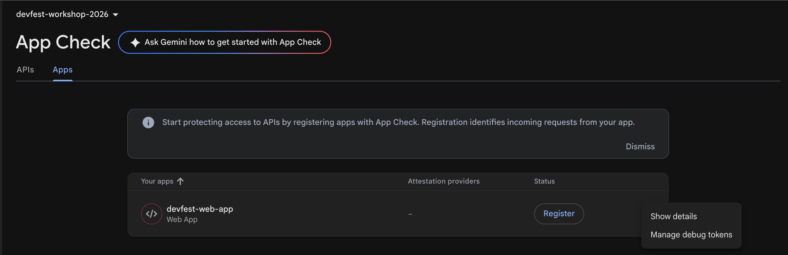

5. Input a recognizable name (for example, `Local Dev`), paste `<app check debug token>` into **Value**, and click **Save**.

**What this means:** Authorizes your local debug token in Firebase App Check so Firebase AI Logic accepts requests from your local machine while keeping App Check enforcement active.

<!-- ------------------------ -->

## Part 2: Update `firebase/.env` and Regenerate `public/firebase.config.json`

Duration: 2

1. Paste that exact registered UUID into `APP_FIREBASE_APPCHECK_DEBUG_TOKEN` in `firebase/.env`:

```env
APP_FIREBASE_WEB_APP_NAME="<App nickname>"
APP_FIREBASE_APPCHECK_DEBUG_TOKEN="<app check debug token>"
```

2. Regenerate `public/firebase.config.json` so `"appCheckDebugToken"` contains your registered UUID, then restart the emulator:

```bash
npm run config:generate
npm run firebase:emulators:start
```

> aside positive
> **What is `"appCheckDebugToken"` and why pin the UUID in `.env`?**
> * **Why not leave it as `true`?** When `FIREBASE_APPCHECK_DEBUG_TOKEN` is `true`, the SDK generates a brand-new random debug token for every browser profile or incognito window, forcing you to register a new token each time. Assigning your registered UUID to `"appCheckDebugToken"` lets **all browsers (Chrome, Safari, Firefox, incognito) and restarts share the exact same debug token**.
> * **Why keep it out of Git?** Unlike your Firebase Web `apiKey`, an `appCheckDebugToken` grants verified access to your protected backend resources (including Firebase AI Logic quota) and **must remain private**. Keeping `firebase/.env` and `public/firebase.config.json` in `.gitignore` ensures you never commit your debug token to GitHub.

**What this means:** Firebase AI Logic blocks unverified requests when App Check is enforced; initializing `FirebaseApp` + `AppCheck` on startup and pinning your registered debug token in `firebase/.env` authorizes your local environment across browsers without exposing secrets in Git.

<!-- ------------------------ -->

## Part 2: Create the Firebase AI Backend in `ConfigService`

Duration: 2

Now that `FirebaseApp` and `AppCheck` are initialized, create the Firebase AI Logic backend instance in `ConfigService` so the rest of your app can access it via `aiBackend`.

1. Open `src/app/core/firebase/config.service.ts`:
   * At the top of the file, import `getAI` and `GoogleAIBackend` from `'firebase/ai'`:

```typescript
import { getAI, GoogleAIBackend } from 'firebase/ai';
```

   * Inside `initialize()` (right below `initializeAppCheck(...)`), initialize `this.#ai`:

```typescript
    this.#ai = getAI(this.#firebaseApp, {
      backend: new GoogleAIBackend(),
      useLimitedUseAppCheckTokens: true,
    });
```

> aside positive
> **Why `GoogleAIBackend` and `useLimitedUseAppCheckTokens`?**
> * **`new GoogleAIBackend()`**: Connects Firebase AI Logic to the Gemini Developer API backend.
> * **`useLimitedUseAppCheckTokens: true`**: Requests single-use App Check tokens for AI Logic calls, adding replay protection for sensitive generative AI endpoints.

**What this means:** Initializes your `AI` backend singleton on `ConfigService` with App Check protection enabled, ready for services to call `configService.aiBackend`.

<!-- ------------------------ -->

## Part 2: Fetch Server Template IDs into `AppRemoteConfig` in `ConfigService`

Duration: 4

Next, update `ConfigService` to fetch your Remote Config parameters and store them in the `#appConfig` signal (`AppRemoteConfig`), which is exposed as the read-only `appConfig` signal.

1. Open `src/app/core/firebase/config.service.ts` and add the Remote Config imports (`remoteConfigDefault`, `isDevMode`, and `firebase/remote-config`):

```typescript
import remoteConfigDefault from '@/public/remote-config-defaults.json';
import { isDevMode, Service, signal } from '@angular/core';
import { fetchAndActivate, getRemoteConfig, getString } from 'firebase/remote-config';
```

2. Add the cache-duration constants above `@Service()`:

```typescript
const SECONDS = 60;
const MILLISECONDS = 1000;
const ONE_HOUR_IN_MILLISECONDS = SECONDS * SECONDS * MILLISECONDS;
```

3. At the end of `initialize()`, call `await this.loadRemoteConfig();`:

```typescript
  async initialize(): Promise<void> {
    // ...omitted...

    await this.loadRemoteConfig();
  }
```

4. Add the `private async loadRemoteConfig()` method to `ConfigService`:

```typescript
  private async loadRemoteConfig(): Promise<void> {
    try {
      const rc = getRemoteConfig(this.app);
      rc.defaultConfig = remoteConfigDefault;
      rc.settings.minimumFetchIntervalMillis = isDevMode() ? 0 : ONE_HOUR_IN_MILLISECONDS;
      await fetchAndActivate(rc);
      this.#appConfig.set({
        summarizeTemplateId: getString(rc, 'summarizeTemplateId'),
        countryTemplateId: getString(rc, 'countryTemplateId'),
      });
      console.log(this.#appConfig());
    } catch (e) {
      console.warn('Remote Config fetch timed out or failed. Using defaults:', e);
    }
  }
```

5. Open `src/app/app.config.ts` and update `provideAppInitializer` to `await configService.initialize()` so Angular waits for Firebase initialization and Remote Config loading to finish before rendering:

```typescript
    provideAppInitializer(async () => {
      const configService = inject(ConfigService);
      await configService.initialize();
    }),
```

**What this means:**
- **Updating the Angular Signal (`this.#appConfig.set(...)`):** `#appConfig` is an Angular Signal initialized with empty default values (`countryTemplateId: ''`, `summarizeTemplateId: ''`). Calling `this.#appConfig.set(...)` overwrites those default values in the signal with the dynamic template IDs fetched from Remote Config, and any code reading `configService.appConfig()` automatically receives the updated values.
- **Dev vs. production fetch interval (`minimumFetchIntervalMillis`):** This setting controls how long the browser caches fetched Remote Config values locally before `fetchAndActivate(rc)` makes another network request. In development (`isDevMode()` is `true`), `0` disables the local cache so template ID changes published in the Firebase Console appear on your next page reload. In production (`isDevMode()` is `false`), `ONE_HOUR_IN_MILLISECONDS` caches values in the browser for 1 hour to reduce network requests and avoid rate limits.
- **Decoupled template versions:** Your Angular app asks Firebase Remote Config which server prompt template ID to run instead of hardcoding template names in client code.

<!-- ------------------------ -->

## Part 2: Implement `AiService` for Server Prompt Templates

Duration: 2

Now implement `AiService`, which uses `aiBackend` from `ConfigService` (`getTemplateGenerativeModel`) and exposes `generateResponse` and `generateInlineData` for calling server prompt templates.

1. Open `src/app/core/firebase/ai.service.ts`, delete the `eslint-disable-next-line` comments, and replace the bodies of `generateResponse` and `generateInlineData`:

```typescript
// ...omitted...

  async generateResponse(request: TemplateRequest): Promise<Content | undefined> {
    const result = await this.getTemplateModel().generateContent(request);
    const response = result.response;

    const firstContent = (response.candidates || []).find((c) => c.content.parts.length > 0);
    return firstContent?.content;
  }

  async generateInlineData(request: TemplateRequest): Promise<GenerativeContentBlob | undefined> {
    const result = await this.getTemplateModel().generateContent(request);
    const response = result.response;

    const parts = response.inlineDataParts();
    if (!parts) {
      return undefined;
    }

    const imagePart = parts.find((part) => !!part);
    return imagePart?.inlineData;
  }
```

**What this means:**
- **Centralized template calls:** Both methods accept a `TemplateRequest` (`templateId` and `templateVariables`) so prompts, model settings, and Google Search grounding remain protected on Firebase servers.
- **`generateResponse` vs. `generateInlineData`:** `generateResponse` returns the first non-empty candidate `Content` for text or structured responses, while `generateInlineData` extracts the first `GenerativeContentBlob` from `inlineDataParts()` for generated images.

<!-- ------------------------ -->

## Part 2: Connect Component Generate Buttons to Services

Duration: 5

1. Open `src/app/features/summarizer/summarizer.component.ts` and add the `AiService`, `ConfigService`, and `inject` imports at the top of the file:

```typescript
import { AiService } from '@/core/firebase/ai.service';
import { ConfigService } from '@/core/firebase/config.service';
import { Component, inject, signal } from '@angular/core';
```

2. At the top of the `SummarizerComponent` class body (right above `summarizerModel`), inject `AiService` and `ConfigService`:

```typescript
export default class SummarizerComponent {
  #aiService = inject(AiService);
  #configService = inject(ConfigService);

  // ...omitted...
```

3. Inside `summarizerForm`, replace the `submission` option so form submission reads `summarizeTemplateId` from `ConfigService` and calls `AiService.generateResponse`:

```typescript
  summarizerForm = form(
    this.summarizerModel,
    (schemaPath) => {
      // ...omitted...
    },
    {
      submission: {
        action: async () => {
          this.videoSummary.set(DEFAULT_VIDEO_SUMMARY);
          try {
            const templateId = this.#configService.appConfig().summarizeTemplateId;
            const result = await this.#aiService.generateResponse({
              templateId,
              templateVariables: this.summarizerModel(),
            });

            const videoSummary =
              result && result.type === 'text' ? (JSON.parse(result.text) as VideoSummary) : DEFAULT_VIDEO_SUMMARY;
            this.videoSummary.set(videoSummary);
            return undefined;
          } catch (e) {
            this.videoSummary.set(DEFAULT_VIDEO_SUMMARY);
            return { kind: 'serverError', message: 'Failed to submit form' };
          }
        },
      },
    },
  );
```

**What `submission.action` does:** When the Signal Form is submitted, `action` reads `summarizeTemplateId` from `#configService.appConfig()`, calls `#aiService.generateResponse(...)` with `this.summarizerModel()`, parses the JSON `VideoSummary` into `this.videoSummary`, and returns `{ kind: 'serverError', message: 'Failed to submit form' }` if the request fails.

Now connect `CountryComponent` to `ConfigService` and `AiService`.

4. Open `src/app/features/country/country.component.ts` and add the `AiService`, `ConfigService`, `computed`, and `inject` imports at the top of the file:

```typescript
import { AiService } from '@/core/firebase/ai.service';
import { ConfigService } from '@/core/firebase/config.service';
import { Component, computed, inject, signal } from '@angular/core';
```

5. Inside the `CountryComponent` class body, inject `AiService` and `ConfigService` right below `readonly countries = countryData.countries;`, and add the `countryTemplateId` computed signal below `imageUrl`:

```typescript
export default class CountryComponent {
  readonly countries = countryData.countries;
  #aiService = inject(AiService);
  #configService = inject(ConfigService);

  // ...omitted...
  imageUrl = signal('');
  countryTemplateId = computed(() => this.#configService.appConfig().countryTemplateId);
```

6. Inside `countryForm`, replace the `submission` option so form submission reads `this.countryTemplateId()` and calls `AiService.generateInlineData`:

```typescript
  countryForm = form(
    this.countryModel,
    (schemaPath) => {
      // ...omitted...
    },
    {
      submission: {
        action: async () => {
          try {
            this.imageUrl.set('');
            const result = await this.#aiService.generateInlineData({
              templateId: this.countryTemplateId(),
              templateVariables: this.countryModel(),
            });

            this.imageUrl.set(result);
            return undefined;
          } catch (e) {
            console.log(e);
            this.imageUrl.set('');
            return { kind: 'serverError', message: 'Failed to submit form' };
          }
        },
      },
    },
  );
```

**What this means:** `countryTemplateId` reacts automatically to changes in `ConfigService.appConfig()`. When the Signal Form is submitted, `submission.action` calls `#aiService.generateInlineData(...)` with `this.countryTemplateId()` and `this.countryModel()`, then updates `this.imageUrl` to render the generated image in the UI.

<!-- ------------------------ -->

## Part 2: Test the App on `http://localhost:5005`

Duration: 3

Verify that the entire local stack works end-to-end before testing Remote Config template switching.

1. Open `http://localhost:5005` in your browser.
2. **Test Country Guide**: Enter a country (for example, `Japan`) and click **Generate**. Verify that the app displays the dish description, the generated food image (`country-food-guide-v0-0-1`), and the Google Search grounding sources.

3. **Test YouTube Summarizer**: Paste a public YouTube URL and click **Generate Summary**. Verify that `summarize-youtube-url-v0-0-1` returns a concise summary.

**What this means:** Confirms the full pipeline—App Check debug token -> Remote Config template IDs -> AI Logic Server Prompt Templates -> grounded multimodal UI output—works together locally.

<!-- ------------------------ -->

## Part 2: Update `countryTemplateId` to Animal Guide and Refresh

Duration: 3

Now update `countryTemplateId` in Remote Config from `country-food-guide-v0-0-1` to `country-animal-guide-v0-0-1` using the CLI scripts, then refresh the browser to see the AI output change with **zero Angular code changes and zero redeployment**.

1. Pull the live Remote Config template from Firebase into `firebase/remote-config-template.json`:

```bash
npm run config:pull
```

* **`npm run config:pull`** (`firebase/scripts/deploy-remote-config.mjs pull`) calls `npx firebase remoteconfig:get --json --project default` and writes `firebase/remote-config-template.json`.
* **Expected Output:**

```text
📥 Pulling active Remote Config template from Firebase Cloud...
✅ Successfully saved live template to: .../firebase/remote-config-template.json
```

2. Open `firebase/remote-config-template.json` and update `countryTemplateId`'s `defaultValue.value` from `country-food-guide-v0-0-1` to `country-animal-guide-v0-0-1`:

```json
"countryTemplateId": {
  "defaultValue": {
    "value": "country-animal-guide-v0-0-1"
  },
  "description": "Country Prompt Template Id",
  "valueType": "STRING"
}
```

3. Push and publish the updated Remote Config template back to Firebase:

```bash
npm run config:push
```

* **`npm run config:push`** (`firebase/scripts/deploy-remote-config.mjs push`) fetches the latest `version` / `etag` metadata from Firebase to prevent `409` conflicts, updates `firebase/remote-config-template.json`, and runs `npx firebase deploy --only remoteconfig --project default`.
* **Expected Output:**

```text
🔄 Preparing to push Remote Config template to Firebase Cloud...
🔍 Fetching latest version metadata to avoid 409 conflicts...
🚀 Deploying template via Firebase CLI...
🎉 Remote Config deployment successfully completed!
```

> aside positive
> **Slow Wi-Fi / CLI Fallback:** If `config:pull` or `config:push` fails on conference Wi-Fi, open **Firebase Console -> Remote Config**, edit `countryTemplateId` to `country-animal-guide-v0-0-1`, click **Save**, and click **Publish changes**.

4. **Refresh** your Angular app at `http://localhost:5005` and submit `Japan` again. The app now generates a **national animal** guide and image—with **no Angular code changes and no redeployment needed**.

**What this means:** Proves that changing Remote Config switches the live AI behavior and prompt template immediately on next fetch without rebuilding or redeploying your frontend.

<!-- ------------------------ -->

## Part 2: Add Real-Time Remote Config Listener & Revert Without Refresh

Duration: 5

Finally, add a real-time Remote Config listener in `ConfigService` so updates to `AppRemoteConfig` take effect in-memory **without refreshing the page**, then revert `countryTemplateId` back to `country-food-guide-v0-0-1`.

1. Open `src/app/core/firebase/config.service.ts` and update the `@angular/core` and `firebase/remote-config` imports at the top of the file:

```typescript
import { DestroyRef, inject, isDevMode, Service, signal } from '@angular/core';
// ...omitted...
import type { RemoteConfig, Unsubscribe } from 'firebase/remote-config';
import { activate, fetchAndActivate, getRemoteConfig, getString, onConfigUpdate } from 'firebase/remote-config';
```

2. Add `#unsubscribe` below `#ai: AI | null = null;`, then add `private registerRemoteConfigListener` at the bottom of `ConfigService` (see [Add a real-time Remote Config listener](https://firebase.google.com/docs/ai-logic/server-prompt-templates/versioning-with-remote-config?api=dev#add-a-real-time-remote-config-listener)):

```typescript
  #unsubscribe: Unsubscribe | null = null;

  // ...omitted...

  private registerRemoteConfigListener(remoteConfig: RemoteConfig): void {
    if (this.#unsubscribe) {
      return;
    }

    this.#unsubscribe = onConfigUpdate(remoteConfig, {
      next: async (configUpdated) => {
        try {
          console.log(configUpdated.getUpdatedKeys());
          await activate(remoteConfig);
          this.#appConfig.set({
            summarizeTemplateId: getString(remoteConfig, 'summarizeTemplateId'),
            countryTemplateId: getString(remoteConfig, 'countryTemplateId'),
          });
        } catch(e) {
          // swallow error
          console.warn('Error in onConfigUpdate():', e)
        }
      },
      error: (error) => {
          console.log("Config update error:", error);
      },
      complete: () => {
          console.log("Listening stopped.");
      }
    });
  }
```

**What `onConfigUpdate(...)` does:** `onConfigUpdate(remoteConfig, ...)` opens a real-time streaming listener to Firebase Remote Config and returns an `Unsubscribe` function (stored in `this.#unsubscribe`). Whenever a new Remote Config version is published, the `next` callback runs `await activate(remoteConfig)` to apply the newly fetched values in-memory and updates `this.#appConfig.set(...)`, so Angular components react immediately without a page reload; `error` and `complete` log connection errors or when listening stops.

3. Inside `loadRemoteConfig()`, call `this.registerRemoteConfigListener(rc);` right after `this.#appConfig.set(...)`:

```typescript
  private async loadRemoteConfig(): Promise<void> {
    try {
      const rc = getRemoteConfig(this.app);
      // ...omitted...
      this.#appConfig.set({
        summarizeTemplateId: getString(rc, 'summarizeTemplateId'),
        countryTemplateId: getString(rc, 'countryTemplateId'),
      });
      this.registerRemoteConfigListener(rc);
    } catch (e) {
      console.warn('Remote Config fetch timed out or failed. Using defaults:', e);
    }
  }
```

4. Finally, add `#destroyRef` right below `#unsubscribe` and add `constructor()` to clean up the listener when `ConfigService` is destroyed:

```typescript
  #unsubscribe: Unsubscribe | null = null;
  #destroyRef = inject(DestroyRef);

  constructor() {
    this.#destroyRef.onDestroy(() => {
      if (this.#unsubscribe) {
        this.#unsubscribe();
        this.#unsubscribe = null;
      }
    });
  }
```

**What `this.#destroyRef.onDestroy(...)` does:** Angular's `DestroyRef` registers a cleanup callback that runs automatically when `ConfigService` is destroyed (such as during app teardown or hot module reload). Calling `this.#unsubscribe()` closes the real-time `onConfigUpdate` stream and resets `#unsubscribe` to `null` to prevent memory leaks or dangling listeners.

> aside positive
> **Note:** Real-time Remote Config updates require enabling the **Firebase Remote Config Realtime API** in your Google Cloud project and keeping an active streaming connection. If conference Wi-Fi drops the stream, refresh the page as a fallback.

5. Revert `countryTemplateId` back to `country-food-guide-v0-0-1` in `firebase/remote-config-template.json`:
   * Run `npm run config:pull` to pull the latest template.
   * Open `firebase/remote-config-template.json` and update `countryTemplateId`'s `defaultValue.value` back to `"country-food-guide-v0-0-1"`:

```json
"countryTemplateId": {
  "defaultValue": {
    "value": "country-food-guide-v0-0-1"
  },
  "description": "Country Prompt Template Id",
  "valueType": "STRING"
}
```

   * Run `npm run config:push` to publish the updated `firebase/remote-config-template.json` back to Firebase (or update and publish in **Firebase Console -> Remote Config**).

6. **Without refreshing** `http://localhost:5005`, submit `Japan` again. `CountryComponent` reads the updated `countryTemplateId` from `ConfigService.appConfig()` and reverts to generating the **Food Guide**.

**What this means:** Demonstrates real-time Remote Config + Angular Signal reactivity—your running app picks up server-side template changes instantly in memory without even a browser refresh.

> aside positive
> **Congratulations!** You have built a secure Angular + Firebase AI Logic application using App Check (with local Debug Mode), Remote Config template versioning with real-time updates, and multimodal Server Prompt Templates grounded with Google Search.

### Further Reading & Resources

* **Angular Documentation**: <a href="https://angular.dev" target="_blank" rel="noopener">https://angular.dev</a>
* **Get started with Firebase AI Logic Server Prompt Templates**: <a href="https://firebase.google.com/docs/ai-logic/server-prompt-templates/get-started?api=dev" target="_blank" rel="noopener">https://firebase.google.com/docs/ai-logic/server-prompt-templates/get-started?api=dev</a>
* **Enforce App Check for Firebase AI Logic**: <a href="https://firebase.google.com/docs/ai-logic/app-check?api=dev" target="_blank" rel="noopener">https://firebase.google.com/docs/ai-logic/app-check?api=dev</a>
* **Manage Server Prompt Template versions with Remote Config**: <a href="https://firebase.google.com/docs/ai-logic/server-prompt-templates/versioning-with-remote-config?api=dev#add-a-real-time-remote-config-listener" target="_blank" rel="noopener">https://firebase.google.com/docs/ai-logic/server-prompt-templates/versioning-with-remote-config?api=dev#add-a-real-time-remote-config-listener</a>
